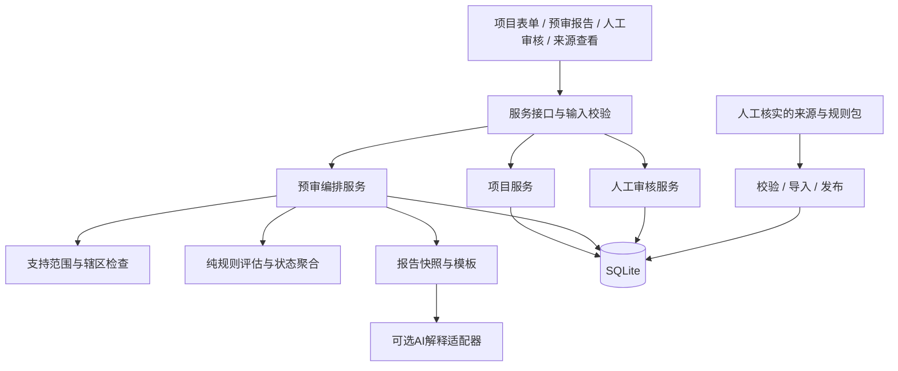

# Nestopia MVP 技术方案

版本：V1.0 / 2026-11-15  
状态：原技术设计，首版实现已开始。实际实现差异及验证结果见文末第15节；法规知识尚无企业专业签认。  
关联文档：《Nestopia_MVP_产品与技术设计.md》《Nestopia_MVP_实现计划清单.md》。本方案细化工程实现；业务范围与验收口径沿用上述文档。

## 1. 目标与边界

首版交付一个可运行的内部合规预审工作台，支持项目录入、辖区与资料检查、逐项判断、证据报告、人工纠错、版本保存和知识复用。

试点暂定Montgomery County独立式ADU，实际规则在官方资料核实后启用。本方案中的字段和条件结构属于系统设计，不表示当地法规要求。

主要技术目标：

- 同一份输入、规则集、审查日期和引擎版本，得到一致的结构化结果。
- 每个关键判断可追溯到项目事实和固定版本的来源。
- 缺信息、适用范围不确定、专业判断与程序失败分别处理。
- 模型故障不破坏规则判断、历史数据和人工审核。
- 用单一应用及本地数据库完成原型，不引入独立工作流平台、向量数据库或多Agent系统。

## 2. 技术选型

| 层次 | 首版方案 | 选择理由与约束 |
|---|---|---|
| 应用 | Next.js App Router + React + TypeScript | 页面和服务接口放同一仓库，减少前后端协调 |
| 页面样式 | Tailwind CSS及少量可复用组件 | 优先表单、表格、状态、证据面板，暂不建设大型组件库 |
| 运行环境 | Node.js运行时 | 数据库与文件操作放服务端，不使用Edge运行时 |
| 数据校验 | Zod | 在服务边界校验项目、规则包和模型输出 |
| 数据存储 | SQLite + better-sqlite3 | 适合本地、单实例原型；数据访问集中封装，不引入ORM |
| 数据变更 | 编号SQL迁移 + schema_migrations记录 | 原型表结构小，迁移受版本管理，避免启动时随意改表 |
| AI调用 | 服务端模型适配器 | 隔离供应商差异，具体模型、SDK及预算实施时确认 |
| 测试 | Vitest + Playwright | 分别验证领域逻辑与少量完整操作流程 |
| 交付 | 本地启动优先；可选持久化单实例服务器 | SQLite数据库与资料快照需要持久磁盘 |

Next.js提供Route Handlers和服务端部署能力；Zod用于运行时数据校验。具体API用法见[Next.js接口文档](https://nextjs.org/docs/app/getting-started/route-handlers)、[部署文档](https://nextjs.org/docs/app/getting-started/deploying)和[Zod官方文档](https://zod.dev/)。本表是项目选型，不是已完成的兼容性测试。

不在文档中固定未经安装验证的精确版本。建项时选择相互兼容、仍受支持的稳定版本，锁定依赖及Node版本，验证Windows安装、构建、数据库读写后再开发主流程。当前环境Node输出为v20.19.6，npm版本检查遇到EPERM路径访问错误；尚未证明依赖安装可用，也不能据此认定需要重装Node。

## 3. 总体架构与模块边界



| 模块 | 职责 | 不承担的工作 |
|---|---|---|
| 项目服务 | 保存项目事实、修订号、辖区确认及材料链接 | 推断未知地块事实 |
| 知识服务 | 查询固定来源、规则及发布版本，校验导入包 | 自动把搜索结果发布为法规 |
| 预审编排 | 固定输入和规则版本，执行流程，保存结果 | 在长事务中等待外部模型 |
| 规则引擎 | 单位处理、适用条件、确定性比较、逐项结果 | 网络请求、数据库写入、自由文本推理 |
| 报告服务 | 汇总结论、待办、许可、来源及说明 | 将预审结论转成政府批准或报价许可 |
| 审核服务 | 追加意见、问题分类、知识修订建议 | 无痕覆盖自动结果 |
| 模型适配器 | 基于指定材料生成候选说明或资料提取结果 | 改写结构化结论、自由访问系统或发布规则 |

首版规则引擎设计为纯函数：输入完整快照，返回结果对象。它与页面、数据库和模型解耦，以便独立测试和复现。

## 4. 数据模型

### 4.1 存储约定

- 所有业务实体使用稳定ID；时间保存为UTC，界面按用户时区显示。
- 当前项目可修改；已完成报告的输入、结果、规则引用和原始审核记录不可覆盖。
- 可搜索、关联或约束的字段使用独立列；灵活的事实、表达式和报告快照可保存为经校验的JSON文本。
- 小规模法规摘录直接入库；原始文件可放私有资料目录，由内容哈希定位，不放公开静态资源目录。
- 开启外键校验；查询使用参数绑定。数据库事务和备份方法参考[better-sqlite3 API](https://github.com/WiseLibs/better-sqlite3/blob/master/docs/api.md)。

### 4.2 核心实体

| 实体 | 主要字段 | 约束与用途 |
|---|---|---|
| Project | id、name、revision、productType、address、factsJson、jurisdictionJson、createdAt、updatedAt | revision用于防止旧页面覆盖新修改 |
| Jurisdiction | id、name、parentId、authorityName、scopeDescription | 标识真正的主管范围，不直接以邮寄城市名判断 |
| SourceVersion | id、sourceKey、version、issuer、title、url、locator、excerpt、contentHash、retrievedAt、verifiedAt、verifiedBy、effectiveFrom/To、verificationStatus | 固定原文版本；更新时间与法律有效时间分开 |
| RuleVersion | id、ruleKey、version、type、applicabilityJson、requiredFactsJson、conditionJson、outcomeJson、critical、sourceIds | 数值审查、人工事项、许可/流程等分类处理 |
| RuleSetRelease | id、scopeJson、version、coverageManifestJson、ruleVersionIds、releaseHash、publishedAt、publishedBy | 一次预审固定一个发布版本；清单列出必审项和未覆盖项 |
| KnowledgeControl | targetType、targetId、availability、reason、changedAt、actor | 追加发布、停用、撤回事件；不改写旧规则内容 |
| Review | id、projectId、sequence、projectRevision、requestKey、requestHash、executionStatus、scopeStatus、conclusion、inputSnapshot、releaseId、assessmentDate、engineVersion、resultSnapshot、startedAt、completedAt、errorCode | 独立版本；总体结论允许为空 |
| ReviewItem | id、reviewId、ruleVersionId、status、reasonCode、observedJson、expectedJson、sourceRefsJson、missingFactsJson、actionsJson | 保存逐项比较证据；和结果快照在同一事务写入 |
| ReviewNote | id、reviewId、reviewItemId、actor、kind、proposedDisposition、reason、evidenceJson、createdAt、supersedesId | 只追加，修正意见通过新记录关联原意见 |
| KnowledgeChange | id、originReviewId、targetKey、errorType、proposal、status、verificationRecord、newReleaseId | 跟踪提出、核实、验证及发布 |
| ReviewNarrative | id、reviewId、status、provider、model、promptVersion、textJson、createdAt、errorCode | AI解释独立保存，不修改规则结果 |

关键约束：

- `(projectId, sequence)`和`(projectId, requestKey)`唯一。
- `(sourceKey, version)`、`(ruleKey, version)`唯一；固定版本被报告引用后禁止删除。
- `ReviewNote.reviewItemId`必须属于同一reviewId，服务端校验并通过组合关联约束实现。
- Review完成结果、ReviewItem及项目最新报告指针一起提交，避免“报告成功但明细丢失”。

### 4.3 项目事实的表达

每个事实包含value、unit（如适用）、status、evidence、confirmedBy及confirmedAt。status可为provided、confirmed、unknown；不同规则可以要求不同证据等级。

`false`、`0`、`unknown`和未提供是不同值。关键事实不因填写了值就自动被视为核实。辖区确认至少保存主管机构、证据、确认人及时间。

单位同时保存原值和归一化值。面积和长度分别处理，比较使用统一尺度及明确精度的十进制/定点表示，禁止跨量纲比较；精度不足以区分边界时转补充信息，不用任意容差放行。

## 5. 法规资料与规则管理

### 5.1 资料处理流程

1. 人工寻找官方来源，记录主管机构及官方入口；商业法规托管站需记录其与官方入口的关联。
2. 保存相关原文和定位，记录内容哈希、获取日期及已知有效时间。
3. 整理候选条件、例外、许可流程；AI提取只能生成草稿。
4. 人工核对原文、上下文、地方适用性及例外。
5. 将确认的事项写入结构化规则包，校验来源引用和所需字段。
6. 执行配套案例，确认后发布固定规则集。
7. 来源变化时创建新版本，记录差异、受影响规则和需要复审的报告。

首版采用受版本管理的资料目录和受控导入命令，不建设爬虫、OCR流水线或完整规则编辑后台。导入命令须在实施时提供干跑校验，导入失败整体回滚，同一包重复导入不重复创建。

### 5.2 发布前校验

- 所有规则引用的来源版本存在且已核实；无法确认有效性的关键规则不允许用于通过判断。
- 适用范围、必要字段、单位、操作符和结果说明完整。
- coverageManifest列出的必审项全部有明确处理路径；不允许规则集为空或仅含不适用项时通过。
- 存在未解决的条款冲突、例外或依据问题时，发布人工审核事项，不能静默选择一条规则。
- 试验规则集与正式演示规则集标记分开；测试数据不得进入真实结果。

哈希用于检查内容一致性，不证明法律有效性；verifiedAt也不等于effectiveFrom。没有明确截止日期的来源需记录核查方法和有效性判断理由。

## 6. 审查引擎

### 6.1 三类状态

| 类型 | 枚举 | 说明 |
|---|---|---|
| 执行状态 | RUNNING、COMPLETED、FAILED | 项目草稿属于项目状态，不混入执行状态 |
| 支持范围 | UNKNOWN、SUPPORTED、UNSUPPORTED | 范围外不执行法规判断，conclusion为空 |
| 总体结论 | PRELIMINARY_PASS、CONFLICT、INSUFFICIENT_INFO、PROFESSIONAL_REVIEW | 仅执行完成且在范围内时产生；范围待确认显示信息不足 |

逐项状态为PASS、CONFLICT、MISSING、MANUAL_REVIEW、NOT_APPLICABLE。NOT_APPLICABLE需要明确适用条件为假；无法确定适用条件时不能跳过。

### 6.2 执行步骤

1. 校验项目修订号，取得固定输入与审查日期。
2. 检查产品和辖区；明确范围外则保存不支持结果，辖区待确认则返回补充信息。
3. 固定规则发布版本、内容哈希、来源及可用状态快照。
4. 检查覆盖完整性、来源有效性和规则适用时间。
5. 逐项判断适用条件；遇到未知输入保留未知，禁止当作false。
6. 对适用事项校验事实和单位，执行受限条件比较，或产生人工审核事项。
7. 生成带引用的许可、流程和周期事项；不能确认时显示待核实。
8. 汇总全部冲突、缺失项和人工事项，生成行动清单与总体状态。
9. 原子保存报告和明细，返回模板结果；AI解释在单独请求中生成。

### 6.3 条件表达式

首版只支持明确的操作符：eq、lt/lte、gt/gte、in、all、any、not。表达式定义为受Zod校验的类型树，不允许eval、动态脚本或任意SQL。

采用三值逻辑：真、假、未知。未知值的组合必须有测试；尤其不能把not(未知)转成真。引擎返回missingFacts和reasonCode，由模板翻译为用户可理解的说明。

示例仅说明表达方式，不含实际法规：

```text
规则类型：数值条件
适用范围：指定辖区、产品及有效时间
必要事实：项目高度（已核实，明确单位）
条件：项目高度 <= 从已核实条款提取的上限
缺事实：信息不足
缺有效依据或存在专业例外：需专业审核
比较不满足：发现冲突，并附两侧值及条款定位
```

### 6.4 总体结论

聚合优先级：有适用且依据有效的冲突 → CONFLICT；否则有必要事实缺失 → INSUFFICIENT_INFO；否则有专业、证据或覆盖问题 → PROFESSIONAL_REVIEW；仅全部必审事项已解决且无冲突时 → PRELIMINARY_PASS。

总体结论不隐藏其他事项。引擎代码异常、非法规则表达式及数据库故障使执行FAILED，不能以专业审核代替程序错误，也不能把部分结果显示成已完成报告。

## 7. 报告与AI能力

### 7.1 两层报告

第一层是必需的结构化报告及模板说明，包含结论、审查范围、逐项结果、证据、缺失信息、人工事项、许可流程、周期及下一步行动。

第二层是可选AI说明，解释已确定的结果、简化英文条款摘要、整理行动建议。优先接入报告解释，资料提取工具作为后续能力，不把两个模型功能同时设为首版前置条件。

### 7.2 模型调用约束

- 只发送本报告必要事实、逐项结果及选定来源摘录；不默认发送客户联系信息和完整地址。
- 模型返回固定结构，如summary、itemExplanations、nextSteps，每条引用只能使用输入中的itemId和sourceVersionId。
- 不接受模型生成的总体结论、数值阈值、许可状态或新链接；这些由规则结果和模板渲染。
- 对输出做结构、引用集合及已知关键值校验；结构合格并不保证语义正确，因此AI段落明确标为辅助解释，关键判断仍显示结构化原结果。
- 网页和法规内容作为待处理资料，不能成为工具指令；模型没有发布、修改数据库或访问内网的工具权限。
- 计划单次超时20秒，最多一次对临时故障重试；在界面显示生成状态，不阻塞报告读取。
- 无密钥、调用失败或校验失败时使用模板，保存真实错误和生成状态，不冒充模型输出。
- 缓存键包含报告结果哈希、提示词版本、模型标识与语言；同一报告可复用解释，避免重复费用。

具体供应商和模型尚未选定，不承诺费用或效果。接入时再核对其官方SDK、数据处理政策、接口及限额。

## 8. 接口与页面

### 8.1 业务接口

| 方法与路径 | 输入重点 | 输出/行为 |
|---|---|---|
| POST /api/projects | 项目名称、产品、已知事实 | 创建草稿，返回id和revision |
| GET /api/projects | 搜索、状态、游标、页大小 | 项目列表与下一页游标 |
| GET /api/projects/:id | 项目ID | 当前事实及最新报告信息 |
| PATCH /api/projects/:id | expectedRevision、变更事实 | 修订号匹配才更新，返回新revision |
| POST /api/projects/:id/reviews | expectedRevision、requestKey | 创建并同步执行确定性预审，返回reviewId和状态 |
| GET /api/projects/:id/reviews | 项目ID、游标 | 固定版本报告列表 |
| GET /api/reviews/:id | 报告ID | 结构化报告、审核意见、失效提示及AI状态 |
| POST /api/reviews/:id/narrative | 报告ID | 按需生成或复用AI解释 |
| POST /api/reviews/:id/notes | 事项、问题类型、意见、证据 | 追加审核意见 |
| GET /api/sources/:id | 固定来源版本ID | 原文摘录与定位 |
| GET /api/rules | 发布版本或范围 | 规则及可用状态 |
| POST /api/knowledge-changes | 关联报告、目标、问题及建议 | 记录修订建议，不自动发布 |
| POST /api/knowledge-controls | 目标、停用/撤回动作、理由 | 仅维护者可执行；首版也可用受控命令代替 |
| GET /api/health | 无业务输入 | 返回基础存活状态，不暴露配置及文件路径 |

业务资料与报告接口明确禁止共享缓存；服务端组件读取数据时复用同一服务层，不需要绕行本机HTTP接口。

### 8.2 校验、重复提交与并发

- 服务端校验所有请求，限制文本长度、数组规模、页大小及允许字段。
- revision不匹配返回409，界面提示先加载新资料，不自动覆盖。
- 同一requestKey和相同请求返回原review；同一key但内容不同返回409。
- 创建RUNNING记录时同时固定输入和规则快照。评估后短事务提交结果，不持有事务等待AI或网络。
- 保存前复查规则是否已被撤回；被撤回则终止本次结果或以固定新输入重新发起，不能静默通过。
- 请求断开后若执行已完成，用户可从历史找回；中断遗留RUNNING在启动恢复检查或查询超时后标记FAILED，并允许新key重试。
- 新报告完成时不能把较晚请求的最新指针覆盖回更早报告；项目已变化时显示报告对应的旧修订号及需重审提示。

统一错误格式：code、message、fieldErrors、requestId。400表示输入错误，404表示目标不存在，409表示版本或幂等冲突，500表示内部错误；未授权/无权限分别使用401/403。

### 8.3 页面结构

```text
/projects                      项目列表
/projects/new                  新建项目
/projects/:id                  项目信息、历史入口
/reviews/:id                   固定报告、证据、审核意见
/knowledge                     来源及规则列表
/sources/:id                   固定版本来源详情
```

使用明确的保存与发起按钮，不做隐式自动审核。报告同时显示“基于哪一版资料”和“是否存在后续变更”；部分报告内容折叠不影响冲突和待办的首屏可见性。

## 9. 人工审核、知识更新与失效处理

人工意见是独立事实，不能把原自动CONFLICT直接改成PASS。界面分别显示自动结论和人工处置：认可、要求补充、不同意、项目例外意见等。后者不自动等于报价批准。

纠错路径：

1. 关联具体报告和事项，记录问题、证据、审核人及影响。
2. 项目事实错误：修订Project并生成新报告。
3. 规则或来源错误：创建KnowledgeChange，必要时立即停用相关规则。
4. 维护者核实后创建新来源/规则版本及规则集；执行原错误及边界案例。
5. 记录验证结果、发布者及新旧版本关系。
6. 根据引用关系列出受影响报告，显示复审提示；原报告结果不改写。

复用的是已核实的知识版本和处理经验。首版不直接复制相似项目结论，不从一次人工意见自动学习出通用法律规则。

## 10. 运行、安全与持久化

### 10.1 两种运行模式

**本地演示：** 单进程绑定127.0.0.1，允许固定演示身份，明显标为演示身份；不把该姓名视为真实身份认证。

**共享试用：** 使用持久磁盘的单实例Node服务器。通过已有身份网关或应用登录建立会话，区分业务用户和知识维护者；维护操作在服务端授权。公共演示只使用模拟资料并限制访问；真实客户资料不在无认证的公开链接中展示。

不是静态导出站点，不直接把本地SQLite文件部署到无持久磁盘的临时实例。多实例或明显增加写并发时迁移到PostgreSQL，迁移时测试事务、约束及JSON语义，不能只改连接字符串。

### 10.2 必要保护

- 密钥仅保存在服务端配置，不进入浏览器包、日志、样例配置或版本库。
- 查询参数化；审核文本按文本展示，外部摘录不直接渲染任意HTML。
- 写接口验证会话、权限和同源请求，使用安全会话Cookie；共享模式启用HTTPS。
- 首版资料导入只处理维护者提供的已下载文件和受控URL，不实现用户任意URL服务器抓取。
- 后续如增加抓取，必须限制目标、重定向、响应大小和超时，阻止访问本机/内网地址。
- 对AI解释生成设置请求频率及输入规模限制，避免重复调用消耗。

### 10.3 数据与备份

数据库、资料快照和备份放在非公开数据目录。启用外键、合理busy timeout；是否启用WAL在安装验证时确定，并考虑备份方式。

提供备份与恢复说明：备份数据库、外部快照、迁移版本和规则包；模型密钥另行管理。运行中使用一致性备份方式，不能只复制正在写入的主数据库文件。方法依据[SQLite官方备份说明](https://www.sqlite.org/backup.html)。交付前恢复到另一目录并核对至少一个项目和报告。

## 11. 工程目录与启动约定

```text
src/
  app/                    页面与接口入口
  components/             表单、结论、证据和审核组件
  domain/                 事实、规则、状态、单位、纯评估逻辑
  services/               项目、预审、报告、审核、知识编排
  repositories/           参数化SQL与事务边界
  integrations/llm/       模型适配器、输出校验
  schemas/                输入、规则包、输出的数据定义
knowledge/                可核查来源清单与规则包（不存客户数据）
migrations/               编号SQL与迁移校验
scripts/                  初始化、导入、验证、备份及恢复
tests/                    领域、持久化与完整流程测试
data/                     本地运行数据，排除版本管理
```

计划命令（尚未实现）：npm ci、npm run setup、npm run dev、npm run build、npm start、npm test、npm run test:e2e。setup只执行受控迁移和明确选定的演示资料导入，不清空现有项目。首次安装与配置和后续单命令启动在README中分开说明。

环境配置最少包括DATA_DIR、APP_MODE、AI_ENABLED，以及启用模型时的供应商、模型和密钥。服务端启动验证缺失配置；AI关闭不要求密钥。依赖、数据及环境配置分别管理，演示重置必须显式指定演示数据目录。

## 12. 测试与验收

| 层次 | 关键测试 | 完成条件 |
|---|---|---|
| 规则逻辑 | 边界、单位、未知值、三值逻辑、不适用、例外、聚合 | 已确认案例及边界结果一致 |
| 证据与覆盖 | 来源缺失/撤回、有效时间、空规则集、必审项缺失 | 不产生错误通过 |
| 数据一致性 | 重复提交、旧修订更新、事务回滚、版本保留 | 不重复、不覆盖、不丢明细 |
| 流程测试 | 新建→预审→查依据→人工意见→修订重审→历史 | 可重复执行且结果可找回 |
| AI隔离 | 超时、错误引用、输出格式错误、无密钥 | 模板报告可用，自动结论不变 |
| 知识纠错 | 原案例失败→规则修订→发布→复验→影响提示 | 修正和受影响范围均可追溯 |
| 运行恢复 | 重启、未完成任务、备份恢复、干净安装 | 数据保留且启动说明可复现 |

规则测试使用固定审查日期，不依赖“今天”导致结果漂移。测试资料与正式资料分开。工具能力参考[Vitest文档](https://vitest.dev/guide/)和[Playwright文档](https://playwright.dev/docs/intro)。

不设未经测量的正确率或效率指标。记录规则首次整理时间、单次预审时间、人工复核耗时、证据关联情况及错误类型；无专业复核时不宣称法律准确率。性能目标暂定小规模本地案例的规则预审数秒内完成，实施后按样例实测，不作为当前已达成指标。

## 13. 实施里程碑与取舍

| 里程碑 | 工程工作 | 验收出口 |
|---|---|---|
| M0：运行验证 | 依赖、Node、SQLite安装构建及文件权限检查 | 本机可启动、读写及重启保留 |
| M1：知识基础 | 来源、规则包、校验、迁移和发布 | 核实的核心规则可导入、可解释 |
| M2：首条路径 | 项目→输入快照→规则评估→模板报告 | 一个完整案例可运行 |
| M3：可靠闭环 | 异常状态、人工意见、历史、修订复验 | 正常和异常案例通过 |
| M4：AI解释 | 模型适配、引用校验、超时回退 | 实时解释可展示且不影响结论 |
| M5：交付 | 完整测试、恢复检查、README、半页说明 | 新环境可运行并完成演示 |

若时间不足，M4可后置，并如实说明模型接入状态；不削减关键证据、异常处理或历史保存。共享部署不强制纳入48小时原型，本地可运行已是交付路径之一。

尚待确定：最终试点、官方规则及例外、专业核实人、报价放行政策、模型供应商、实际部署环境。系统结构可先实施；未核实规则和未确认业务政策不提前启用。

## 14. 核心技术决策记录

1. 单应用降低交付成本，业务服务与规则逻辑仍保持独立，便于后续扩展。
2. 规则引擎控制确定性判断，AI负责受证据约束的辅助解释。
3. 不做向量检索，首版通过辖区、产品、时间和事项精确选择已核实规则。
4. 固定版本报告与追加式人工意见，避免历史结果随更新漂移。
5. SQLite只用于持久化单实例原型，明确后续迁移条件。
6. 资料导入和规则发布采用受控操作，人工纠错不直接变成自动全局学习。

上述决策优先支持原题要求的可运行、可解释、可纠错原型；后续技术扩展以实际案例量、维护成本和业务反馈为依据。

## 15. 首版实现记录（2026-11-15）

- 已实现Next.js本地工作台、项目保存、有限确定性审查、依据面板、历史版本、人工意见、知识修订建议及规则集停用。
- 根据用户要求，界面采用iOS风格：浅灰背景、白色圆角分组、蓝色操作、分段控件及半透明弹窗遮罩；使用系统字体栈。
- better-sqlite3在本机因预编译下载及C++工具链条件未能安装，改用sql.js 1.13.0。保留标准SQLite文件、参数化SQL及事务；每次写入导出快照并替换磁盘文件，以进程锁限制同一数据目录单进程。该方案只适合小型原型，全库导出成本会随数据增长。
- 判断流程以TypeScript实现，参数与资料通过JSON知识包维护；已实现结构校验、六类案例复验、人工核实和不可覆盖版本发布命令，暂未建设通用表达式解释器及网页编辑后台。每份报告保存固定输入、结果、来源摘要、参数及知识版本指纹。面积比较采用十进制整数缩放，避免浮点边界误差。
- 预审同步执行，失败回滚并返回错误，尚未保存独立失败执行记录。单次成功预审记录独立版本。
- 已接入DeepSeek `deepseek-flash`服务端Chat Completions接口，按需生成JSON解释。原规则结论保持独立；检查返回结构、结论代码、事项状态和引用归属，失败回退规则说明。解释单独保存，成功结果复用；异步调用结束前再次核实报告是否过期。默认30秒超时，单进程最大两路请求，不自动重试。密钥位于本地服务端环境变量；不发送项目名称、完整地址、审核人或人工核实记录原文。自然语言准确性仍须专业评估。
- 当前只提供本机访问，没有真实登录或多人权限。手工审核人是记录标签，不能当作身份认证。
- 现行资料基于2026-10-05生效的Ordinance 20-36；旧版DHCA文档仅作参考，Bill 41-26许可变动保留人工核实。设30天资料复核窗口，不将它称为法律有效期。
- 自动测试和实际浏览器验证的最终结果以README及开发进度记录为准。
